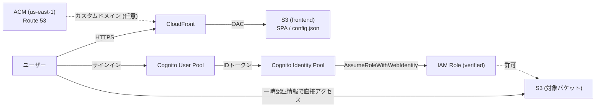

# terraform-aws-storage_browser
Terraform module to create AWS Storage Browser for S3

S3バケットをブラウザから操作できる [Storage Browser for Amazon S3](https://docs.amplify.aws/react/build-a-backend/storage/set-up-storage/) の実行環境を、`terraform apply` だけで構築するモジュールです。  
Cognito (認証・認可)、S3 + CloudFront (SPAの配信)、およびSPA本体 (`app/`) までを含みます。

## 構成


| リソース | 内容 |
| --- | --- |
| S3 (frontend) | SPAの配置先。CloudFront (OAC) からのみ読み取り可、SSL必須、バージョニング有効 (旧バージョンは最大9世代・90日で削除) |
| CloudFront | SPAの配信。`/assets/*` のみ長期キャッシュ、それ以外はキャッシュ無効 (invalidation不要)。403は `index.html` にフォールバック (SPA) |
| Cognito User Pool / Client | ユーザー管理・認証。**自己サインアップは無効** (管理者がユーザーを作成) |
| Cognito Identity Pool | 認証済みユーザーに、対象バケットを操作するための一時認証情報を払い出す |
| IAM Role | `verified`: 対象バケットへの `ListBucket` / `GetObject` / `PutObject` / `DeleteObject` を許可。`unverified`: 権限なし |
| S3 Object | `app/dist` のファイルと、環境依存の値を含む `config.json` |
| ACM / Route 53 | `custom_domain_name` 指定時のみ。証明書 (us-east-1) の発行、DNS検証、エイリアスレコード |

## 前提
* 操作対象のS3バケットは別途用意し、**CORS** で本モジュールのフロントエンドURLを許可してください  
  (許可するメソッド・ヘッダーは [examples/terraform/s3.tf](examples/terraform/s3.tf) を参照)
* `terraform apply` の実行環境から `app/dist` を参照できること (HCP Terraform等でも `local-exec` は不要)

## 使い方
```hcl
module "storagebrowser" {
  source = "git::https://github.com/AhiruMarsh/terraform-aws-storage_browser?ref=<タグ>"

  prefix_name                = "storagebrowser"
  target_s3_bucket_name_list = [aws_s3_bucket.target.id]

  # カスタムドメイン (任意)
  # custom_domain_name = "storage.example.com"
  # route53_zone_id    = "Z0123456789ABCDEFGHIJ"
}
```

`?ref=` にはタグ等を指定して固定してください。省略すると既定ブランチの最新の `app/dist` が使われます。

### ユーザーの作成
自己サインアップは無効のため、管理者がユーザーを作成します。

```sh
aws cognito-idp admin-create-user \
  --user-pool-id <cognito_user_pool_id> \
  --username <メールアドレス> \
  --user-attributes Name=email,Value=<メールアドレス> Name=email_verified,Value=true
```

## 変数
| 変数名 | 必須 | 既定値 | 説明 |
| --- | --- | --- | --- |
| `prefix_name` | | `storagebrowser` | リソース名のプレフィックス |
| `target_s3_bucket_name_list` | | `[]` | 操作対象のS3バケット名のリスト (先頭が既定のバケット) |
| `frontend_url` | | `null` | フロントエンドのURL。未指定時は `custom_domain_name`、なければCloudFrontのドメイン |
| `cloudfront_function_arn` | | `null` | viewer-requestに関連付けるCloudFront FunctionのARN (開発環境のヘッダー制限など) |
| `custom_domain_name` | | `null` | CloudFrontのカスタムドメイン (FQDN)。指定するとACM証明書を発行して適用 |
| `route53_zone_id` | | `null` | `custom_domain_name` のRoute 53ホストゾーンID。指定するとDNS検証とエイリアスも自動作成 |

## 出力
| 名前 | 説明 |
| --- | --- |
| `cloudfront_distribution_fqdn` | CloudFrontのドメイン名 |
| `cognito_user_pool_id` | Cognito User PoolのID |
| `cognito_user_pool_client_id` | Cognito User Pool ClientのID |
| `cognito_identity_pool_id` | Cognito Identity PoolのID |
| `custom_domain_name` | カスタムドメイン (未設定時は `null`) |
| `acm_validation_records` | ACMのDNS検証レコード (Route 53を使わない場合に登録) |

## examples
| ディレクトリ | 用途 | モジュールの参照 |
| --- | --- | --- |
| [examples/terraform/](examples/terraform/) | **実際の利用例**。本モジュールを利用する側の構成として参考にしてください | Git (`git::https://...?ref=`) |
| [examples/for_develop/](examples/for_develop/) | **本モジュールを開発するための専用環境**。利用者向けではありません | ローカル (`../../`) |

`examples/for_develop/` は、変更中のモジュールをそのまま plan / apply して確認するための環境です。  
`examples/terraform/` の `providers.tf` / `s3.tf` / `variables.tf` をシンボリックリンクで共有し、開発用の追加リソース (CloudFront Functionによるヘッダー制限) だけを持ちます。  
開発環境のCloudFrontは、`restricted_header_name` / `restricted_header_value` で指定したヘッダーがないリクエストを拒否します。

## SPAの仕組み
1. **ビルド**: `app/` を変更したPRで、GitHub Actions ([build-app.yml](.github/workflows/build-app.yml)) が `app/dist` をビルドしてコミットします
2. **配置**: Terraform が `app/dist` をS3にアップロードします ([app.tf](app.tf))
3. **設定**: Cognito のIDや対象バケット名は、Terraform が `config.json` として生成します。アプリは起動時に `/config.json` を取得するため、ビルド成果物は環境に依存しません

アプリの更新 = モジュールの更新です。利用側は `source` の `?ref=` を更新して `terraform apply` してください。

## カスタムドメイン
`custom_domain_name` を指定すると、CloudFrontにカスタムドメインを設定し、ACM証明書をus-east-1に発行します。

* `route53_zone_id` も指定: DNS検証レコードとCloudFrontへのエイリアス (A/AAAA) まで自動で作成します
* `route53_zone_id` 未指定: 出力 `acm_validation_records` のCNAMEを自前のDNSに登録してください。  
  証明書の検証が完了するまで apply は待機するため、apply中にACMコンソールに表示されるレコードを登録します。CloudFrontへのCNAME/ALIASも自前で登録が必要です
* CognitoのコールバックURLは `frontend_url` → `custom_domain_name` → CloudFrontドメインの順で決まります

## フォルダ・ファイル構成
```
.
├── .github/
│   └── workflows/
│       ├── build-app.yml          # app/dist のビルドとコミット (PR時)
│       └── documentation.yml      # terraform-docsによるドキュメント生成 (PR時)
├── app/                           # SPA (React + Vite + Amplify UI)
│   ├── src/                       # アプリのソースコード
│   ├── dist/                      # ビルド成果物 (CIが自動コミット)
│   └── config.example.json        # ローカル開発用の /config.json の例
├── examples/
│   ├── terraform/                 # 実際の利用例 (モジュールをGitから参照)
│   └── for_develop/               # モジュール開発専用環境 (ローカル参照 + ヘッダー制限)
├── app.tf                         # app/dist と config.json のアップロード
├── cloudfront.tf                  # CloudFront
├── cognito.tf                     # Cognito (User Pool / Identity Pool)
├── custom_domain.tf               # ACM / Route 53 (カスタムドメイン)
├── iam.tf                         # Identity Pool用のIAMロール
├── s3.tf                          # S3 (frontend)
├── main.tf                        # 共通のlocals
├── variables.tf
└── outputs.tf
```

## 開発
### アプリ
[app/README.md](app/README.md) を参照してください。

```sh
cd app
cp config.example.json public/config.json   # Terraformの出力値で編集
npm ci
npm run dev
```

`app/dist` は CI が生成するため、手元でコミットする必要はありません。

### Terraform
モジュールの変更は、開発専用環境の `examples/for_develop/` で確認します (`examples/terraform/` は利用例のため、開発には使いません)。  
アクセス時は `restricted_header_name` / `restricted_header_value` で指定したヘッダーを付けてください。

```sh
cd examples/for_develop
terraform init
terraform plan
```

モジュールの入出力を追加・変更した場合は、利用例の `examples/terraform/` も合わせて更新してください。

### ドキュメント
以下の `terraform-docs` の出力は、PR時に `.github/workflows/documentation.yml` が自動更新します。

<!-- BEGIN_TF_DOCS -->
## Requirements

No requirements.

## Providers

| Name | Version |
|------|---------|
| <a name="provider_aws"></a> [aws](#provider\_aws) | n/a |

## Modules

No modules.

## Resources

| Name | Type |
|------|------|
| [aws_acm_certificate.frontend](https://registry.terraform.io/providers/hashicorp/aws/latest/docs/resources/acm_certificate) | resource |
| [aws_acm_certificate_validation.frontend](https://registry.terraform.io/providers/hashicorp/aws/latest/docs/resources/acm_certificate_validation) | resource |
| [aws_cloudfront_distribution.frontend](https://registry.terraform.io/providers/hashicorp/aws/latest/docs/resources/cloudfront_distribution) | resource |
| [aws_cloudfront_origin_access_control.frontend](https://registry.terraform.io/providers/hashicorp/aws/latest/docs/resources/cloudfront_origin_access_control) | resource |
| [aws_cloudfront_response_headers_policy.frontend](https://registry.terraform.io/providers/hashicorp/aws/latest/docs/resources/cloudfront_response_headers_policy) | resource |
| [aws_cognito_identity_pool.authz_frontend](https://registry.terraform.io/providers/hashicorp/aws/latest/docs/resources/cognito_identity_pool) | resource |
| [aws_cognito_identity_pool_roles_attachment.authz_frontend](https://registry.terraform.io/providers/hashicorp/aws/latest/docs/resources/cognito_identity_pool_roles_attachment) | resource |
| [aws_cognito_user_pool.authn](https://registry.terraform.io/providers/hashicorp/aws/latest/docs/resources/cognito_user_pool) | resource |
| [aws_cognito_user_pool_client.authn_frontend](https://registry.terraform.io/providers/hashicorp/aws/latest/docs/resources/cognito_user_pool_client) | resource |
| [aws_iam_role.authz_unverified](https://registry.terraform.io/providers/hashicorp/aws/latest/docs/resources/iam_role) | resource |
| [aws_iam_role.authz_verified](https://registry.terraform.io/providers/hashicorp/aws/latest/docs/resources/iam_role) | resource |
| [aws_iam_role_policy.authz_verified](https://registry.terraform.io/providers/hashicorp/aws/latest/docs/resources/iam_role_policy) | resource |
| [aws_route53_record.acm_validation](https://registry.terraform.io/providers/hashicorp/aws/latest/docs/resources/route53_record) | resource |
| [aws_route53_record.frontend](https://registry.terraform.io/providers/hashicorp/aws/latest/docs/resources/route53_record) | resource |
| [aws_s3_bucket.frontend](https://registry.terraform.io/providers/hashicorp/aws/latest/docs/resources/s3_bucket) | resource |
| [aws_s3_bucket_lifecycle_configuration.frontend](https://registry.terraform.io/providers/hashicorp/aws/latest/docs/resources/s3_bucket_lifecycle_configuration) | resource |
| [aws_s3_bucket_ownership_controls.frontend](https://registry.terraform.io/providers/hashicorp/aws/latest/docs/resources/s3_bucket_ownership_controls) | resource |
| [aws_s3_bucket_policy.frontend](https://registry.terraform.io/providers/hashicorp/aws/latest/docs/resources/s3_bucket_policy) | resource |
| [aws_s3_bucket_public_access_block.frontend](https://registry.terraform.io/providers/hashicorp/aws/latest/docs/resources/s3_bucket_public_access_block) | resource |
| [aws_s3_bucket_server_side_encryption_configuration.frontend](https://registry.terraform.io/providers/hashicorp/aws/latest/docs/resources/s3_bucket_server_side_encryption_configuration) | resource |
| [aws_s3_bucket_versioning.frontend](https://registry.terraform.io/providers/hashicorp/aws/latest/docs/resources/s3_bucket_versioning) | resource |
| [aws_s3_object.app](https://registry.terraform.io/providers/hashicorp/aws/latest/docs/resources/s3_object) | resource |
| [aws_s3_object.config](https://registry.terraform.io/providers/hashicorp/aws/latest/docs/resources/s3_object) | resource |
| [aws_caller_identity.current](https://registry.terraform.io/providers/hashicorp/aws/latest/docs/data-sources/caller_identity) | data source |
| [aws_cloudfront_cache_policy.caching_disabled](https://registry.terraform.io/providers/hashicorp/aws/latest/docs/data-sources/cloudfront_cache_policy) | data source |
| [aws_cloudfront_cache_policy.caching_optimized](https://registry.terraform.io/providers/hashicorp/aws/latest/docs/data-sources/cloudfront_cache_policy) | data source |
| [aws_iam_policy_document.authz_unverified_assume_role](https://registry.terraform.io/providers/hashicorp/aws/latest/docs/data-sources/iam_policy_document) | data source |
| [aws_iam_policy_document.authz_verified_assume_role](https://registry.terraform.io/providers/hashicorp/aws/latest/docs/data-sources/iam_policy_document) | data source |
| [aws_iam_policy_document.authz_verified_iam_policy](https://registry.terraform.io/providers/hashicorp/aws/latest/docs/data-sources/iam_policy_document) | data source |
| [aws_iam_policy_document.frontend_bucket_policy](https://registry.terraform.io/providers/hashicorp/aws/latest/docs/data-sources/iam_policy_document) | data source |
| [aws_region.current](https://registry.terraform.io/providers/hashicorp/aws/latest/docs/data-sources/region) | data source |

## Inputs

| Name | Description | Type | Default | Required |
|------|-------------|------|---------|:--------:|
| <a name="input_cloudfront_function_arn"></a> [cloudfront\_function\_arn](#input\_cloudfront\_function\_arn) | ARN of the CloudFront Function to associate with the viewer-request event of the default cache behavior (e.g. header restriction for development environments) | `string` | `null` | no |
| <a name="input_custom_domain_name"></a> [custom\_domain\_name](#input\_custom\_domain\_name) | Custom domain name (FQDN) for the CloudFront distribution. When set, an ACM certificate is issued in us-east-1 and attached to the distribution | `string` | `null` | no |
| <a name="input_frontend_url"></a> [frontend\_url](#input\_frontend\_url) | frontend URL | `string` | `null` | no |
| <a name="input_prefix_name"></a> [prefix\_name](#input\_prefix\_name) | Prefix name | `string` | `"storagebrowser"` | no |
| <a name="input_route53_zone_id"></a> [route53\_zone\_id](#input\_route53\_zone\_id) | Route 53 hosted zone ID of custom\_domain\_name. When set, ACM DNS validation records and alias records (A/AAAA) are created automatically. When null, register the records in acm\_validation\_records in your own DNS (apply waits until the certificate is validated) | `string` | `null` | no |
| <a name="input_target_s3_bucket_name_list"></a> [target\_s3\_bucket\_name\_list](#input\_target\_s3\_bucket\_name\_list) | List of target S3 bucket name | `list(string)` | `[]` | no |

## Outputs

| Name | Description |
|------|-------------|
| <a name="output_acm_validation_records"></a> [acm\_validation\_records](#output\_acm\_validation\_records) | ACM DNS validation records. Register these in your DNS when route53\_zone\_id is not set |
| <a name="output_cloudfront_distribution_fqdn"></a> [cloudfront\_distribution\_fqdn](#output\_cloudfront\_distribution\_fqdn) | n/a |
| <a name="output_cognito_identity_pool_id"></a> [cognito\_identity\_pool\_id](#output\_cognito\_identity\_pool\_id) | n/a |
| <a name="output_cognito_user_pool_client_id"></a> [cognito\_user\_pool\_client\_id](#output\_cognito\_user\_pool\_client\_id) | n/a |
| <a name="output_cognito_user_pool_id"></a> [cognito\_user\_pool\_id](#output\_cognito\_user\_pool\_id) | n/a |
| <a name="output_custom_domain_name"></a> [custom\_domain\_name](#output\_custom\_domain\_name) | Custom domain name of the CloudFront distribution (null when not configured) |
<!-- END_TF_DOCS -->